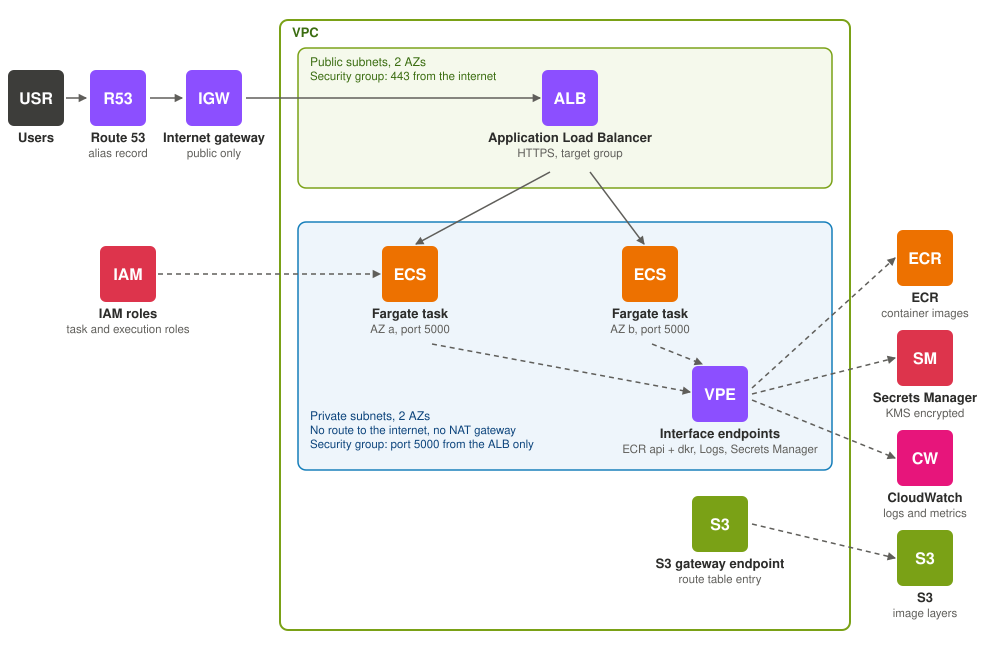
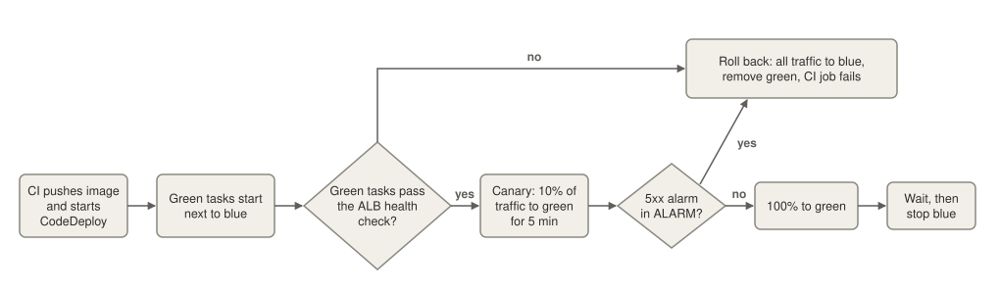
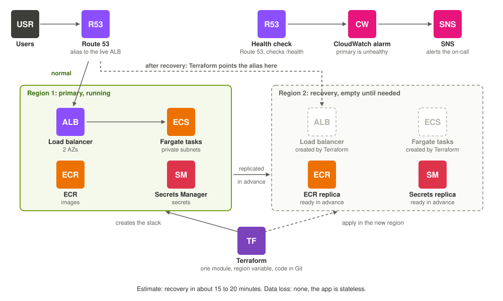

# Architecture

## Part A: Local implementation

### Routing: why Nginx

- **One public door:** Nginx on `localhost:8080`. App containers have no public port, so v1 and v2 can run side by side.
- **The switch is one line in one file:** `server mockapp-v2-0-0:5000;`, then `nginx -s reload`.
- **Graceful reload:** new workers take new requests, old workers **finish the requests they already have**, then exit.
  The port never closes.
- **Why not Traefik:** it can switch by itself from labels, but that hides the moment of the switch. Here I can see and test it (`nginx -t`).

### State: how the tool knows what is live

| What | Where | Role |
|---|---|---|
| **Where traffic goes** | Nginx upstream file | **The truth.** It decides what users get. |
| Which version is live | `state/active.json` | A copy. Written atomically (temp file, then rename). |
| Which containers are ours | Docker labels | Both `app` and `managed-by` are needed to be touched. |
| One deploy at a time | `state/deploy.lock` (`flock`) | Second deploy: exit 3. The OS frees the lock if the process dies. |

**Reconcile, at the start of every run:** trust the Nginx file, check the public `/version`, remove leftover containers of ours,
repair `active.json`. After any crash, run the same command again.

### How downtime is prevented

1. **Start the new version next to the old one.** The old one keeps serving.
2. **Health gate:** checked from inside the proxy (same path as real traffic). **3 passes in a row** before the timeout.
3. **The moment of the switch:** write the new upstream line, `nginx -t`, then a **graceful reload**.
4. **Check from outside:** `localhost:8080/version` must show the new version within 5 seconds. If not, **switch back**.
5. **Drain 5 seconds** (old container still running), then SIGTERM. Gunicorn finishes its open requests. Then remove it.

**Why it is safe:** the old version is never touched until the new one has proved itself.

| If this happens | Result |
|---|---|
| Unhealthy, timeout, or Ctrl+C **before** the switch | Remove only the new container. Exit 1. Users never noticed. |
| Ctrl+C **during** the switch | Ignored until the switch is done, so it is never half finished. |
| Switch not visible from outside | Switch back, check the old version is public, then remove the new one. Exit 1. |
| Switch back cannot be checked | Keep **both** containers, print what to check. Exit 4. |

**Measured:** about 400 requests during a deploy, 0 failed. This is a check for simple requests, not a proof for every long connection.

## Part B: AWS enterprise mapping

The same workflow as the local tool. AWS services do each job.

### Infrastructure

| Local | AWS |
|---|---|
| `mockapp-vX` containers | ECS on Fargate, one task per container, in two Availability Zones |
| Nginx proxy | Application Load Balancer with a target group and a `/health` check |
| `localhost:8080` | Route 53 alias to the ALB, with HTTPS |

- **Tasks are private.** They have no public IP. Only the ALB can reach them: the task security group allows port 5000
  from the ALB security group and nothing else.
- **No internet path.** The VPC has an internet gateway for the public subnets only. The private subnets have no route
  to it, and there is no NAT gateway.
- **AWS services through VPC endpoints.** Interface endpoints for ECR, CloudWatch Logs and Secrets Manager, and an S3
  gateway endpoint (ECR keeps image layers in S3). Traffic to them stays on the AWS network.
- **Scaling:** ECS service auto scaling, min 2 tasks (one per AZ) and max 10. A target tracking policy keeps average CPU
  near 60% (or ALB requests per target). CloudWatch watches the metric: it adds tasks fast, and removes them slowly.
  A task that is removed is first deregistered from the ALB, so open requests finish.
- **If the app ever needs the public internet** (a third-party API), add a NAT gateway. It is not needed here.

### CI/CD and canary deployment

| Local | AWS |
|---|---|
| `deploy.py` | GitHub Actions starts a CodeDeploy blue/green deployment |
| Health gate | ALB health check on `/health`, 3 passes in a row. CodeDeploy waits until green is healthy. |
| Switch upstream and reload | CodeDeploy moves the ALB listener weights between the blue and green target groups |
| Drain, then SIGTERM | ALB deregistration delay (30 s) and ECS `stopTimeout` |
| `flock` | CodeDeploy runs one deployment per service at a time |
| Exit code 1 | A rolled-back deployment fails the CI job |

- **Canary:** 10% of traffic for 5 minutes, then 100% (`CodeDeployDefault.ECSCanary10Percent5Minutes`).
- **Rollback trigger:** a CloudWatch alarm on the 5xx rate of the green target group, for example above 2% for
  2 of 3 minutes. It is attached to the deployment group, so an alarm sends traffic back to blue.
- **Instant rollback:** blue keeps running until the deployment succeeds, so rollback is moving the weight back.

### Security

| Area | Choice |
|---|---|
| IAM | One role per job: task execution (pull image, write logs, read named secrets), task (what the app needs), CodeDeploy. CI uses GitHub OIDC: no stored keys, limited to this repo and branch. |
| Network | ALB in public subnets. Tasks in private subnets with no public IP. The task security group allows port 5000 only from the ALB. VPC endpoints, so no internet path. |
| Secrets | Secrets Manager with KMS and rotation, injected at task start. Never in the image or the repo. |
| Images | ECR scan on push and immutable tags. |

### High availability and disaster recovery

- **One zone fails:** the ALB and at least 2 tasks run in 2 Availability Zones. ECS replaces a failed task by itself.
- **A whole region fails:** the stack is written in **Terraform**, one module run once per region with a `region`
  variable. It is small, so a new region is built from the same code. No standby runs in the second region, so
  downtime during recovery is accepted.
- **Ready in advance, with no servers running:** ECR image replication, Secrets Manager replica secrets, and an
  S3 bucket in region 2 for the Terraform state of region 2. Each region has its own state, so region 2 never
  needs region 1.
- **Alert:** a Route 53 health check on the public URL raises a CloudWatch alarm, and SNS notifies the on-call.
  A person starts the recovery.
- **Recovery:** run Terraform for region 2 (a CI job). Terraform then points the Route 53 alias to the new ALB.
  When region 1 is back, switch the alias back and destroy region 2.
- **Estimate:** recovery in about 15 to 20 minutes. Data loss: none, because the app is stateless.
